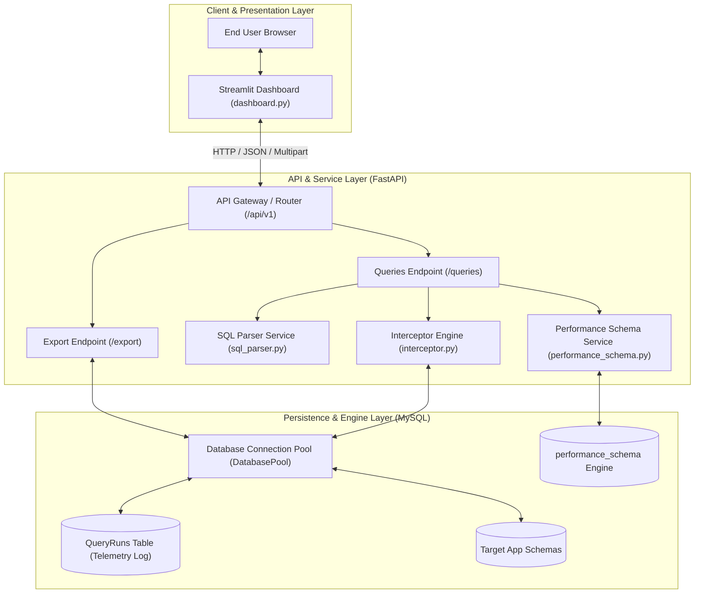
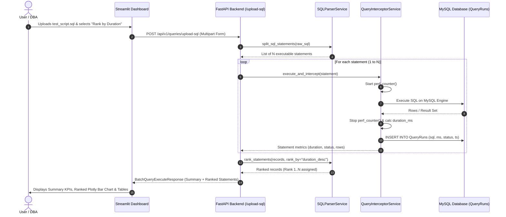

# 🦈 QueryShark — Project Architecture & Theoretical Guide

A comprehensive, step-by-step conceptual walkthrough of the **QueryShark** database performance profiling, query interception, batch SQL execution, and multi-criteria ranking engine.

---

## 📑 Table of Contents
1. [Executive Summary & Problem Statement](#1-executive-summary--problem-statement)
2. [Theoretical Foundations & Engineering Concepts](#2-theoretical-foundations--engineering-concepts)
   - [2.1 The Database "Black Box" Problem](#21-the-database-black-box-problem)
   - [2.2 Connection Pooling Theory & Resource Economics](#22-connection-pooling-theory--resource-economics)
   - [2.3 The Interceptor Pattern & Microsecond Profiling](#23-the-interceptor-pattern--microsecond-profiling)
   - [2.4 SLA Thresholding & Latency Distribution](#24-sla-thresholding--latency-distribution)
   - [2.5 MySQL Performance Schema Deep-Dive](#25-mysql-performance-schema-deep-dive)
   - [2.6 SQL Lexical Parsing & Statement Tokenization](#26-sql-lexical-parsing--statement-tokenization)
   - [2.7 Multi-Criteria Query Ranking Theory](#27-multi-criteria-query-ranking-theory)
3. [Step-by-Step Theoretical Workflow of QueryShark](#3-step-by-step-theoretical-workflow-of-queryshark)
   - [Step 1: Configuration & Lifespan Bootstrapping](#step-1-configuration--lifespan-bootstrapping)
   - [Step 2: Database Schema & Index Provisioning](#step-2-database-schema--index-provisioning)
   - [Step 3: Query Ingestion Modes (Single Command vs .SQL File)](#step-3-query-ingestion-modes-single-command-vs-sql-file)
   - [Step 4: Lexical Parsing & Statement Isolation](#step-4-lexical-parsing--statement-isolation)
   - [Step 5: Query Interception & Wall-Clock Timing](#step-5-query-interception--wall-clock-timing)
   - [Step 6: Telemetry Logging & Status Tagging](#step-6-telemetry-logging--status-tagging)
   - [Step 7: Ranking Engine Computation](#step-7-ranking-engine-computation)
   - [Step 8: Metric Aggregation & Telemetry Rollup](#step-8-metric-aggregation--telemetry-rollup)
   - [Step 9: Visualization & Diagnostic Delivery](#step-9-visualization--diagnostic-delivery)
4. [System Architecture Diagrams](#4-system-architecture-diagrams)
5. [Industry Value & Real-World Use Cases](#5-industry-value--real-world-use-cases)

---

## 1. Executive Summary & Problem Statement

In modern distributed software systems, **database queries are the single most frequent cause of application latency spikes, thread starvation, and service degradations**. 

While backend code is frequently profiled, analyzed, and traced, databases often remain an opaque "black box" where:
1. Developers write queries without immediate feedback on execution latency.
2. Long-running migrations or batch `.sql` scripts contain hidden bottlenecks where 1 out of 100 statements consumes 95% of the total runtime.
3. Native database slow logs either introduce I/O overhead, require elevated administrative privileges, or aggregate data asynchronously after damage has occurred.

**QueryShark** was engineered as an **industry-standard, non-invasive query performance interception and diagnostic platform**. It provides:
- **Immediate Interception**: Intercepts queries as they execute, capturing high-resolution latency with zero sampling loss.
- **Batch .SQL File Profiling**: Ingests complete `.sql` script files, safely isolates each statement, profiles latency, and ranks statements to isolate bottlenecks.
- **Multi-Criteria Ranking Engine**: Sorts queries by latency (slowest first), execution order, error status, or data mutation volume.
- **Interactive Observability**: Delivers real-time dashboards with telemetry KPIs, timeline charts, and instant reporting.

---

## 2. Theoretical Foundations & Engineering Concepts

### 2.1 The Database "Black Box" Problem
When an application sends a SQL query to a relational database engine (like MySQL InnoDB), the statement passes through several internal subsystems:
1. **Parser & Lexer**: Validates syntax and builds an Abstract Syntax Tree (AST).
2. **Query Optimizer**: Evaluates possible execution plans, index cardinality, and table statistics to select an execution path.
3. **Storage Engine (InnoDB)**: Navigates B+ Trees, fetches data pages into the Buffer Pool, executes row reads/writes, manages lock acquisition (record locks, gap locks), and writes to the Write-Ahead Log (WAL / Redo log).

Application developers typically only observe the final result set. Without query interception, developers cannot determine whether an endpoint took 250ms due to Python CPU overhead, network latency, or a missing index in MySQL. QueryShark eliminates this blind spot by measuring the exact round-trip execution latency at the database boundary.

### 2.2 Connection Pooling Theory & Resource Economics
Opening a TCP connection to MySQL is computationally expensive:
- A 3-way TCP handshake ($SYN \to SYN-ACK \to ACK$).
- SSL/TLS handshake negotiations.
- MySQL authentication handshake (password hashing, privilege verification).
- Allocation of connection memory buffers (`read_buffer_size`, `sort_buffer_size`, thread stack) on the MySQL host.

If an application opens and closes connections on every query request, the server suffers from connection churn, ephemeral port exhaustion, and CPU saturation.

**QueryShark Solution**: We implement a thread-safe, reusable **MySQL Connection Pool** (`DatabasePool`). When a query or batch script executes:
- A pre-warmed connection is checked out in $O(1)$ time.
- The query executes with minimal connection overhead.
- The connection is cleanly yielded back to the pool via a Python context manager (`finally: connection.close()`).

### 2.3 The Interceptor Pattern & Microsecond Profiling
QueryShark leverages the **Interceptor Pattern** (a specialized form of the Chain-of-Responsibility pattern). The interceptor wraps the raw database call, acting as a transparent proxy.

#### Why `time.perf_counter()` instead of `time.time()`?
Standard system time (`time.time()`) references wall-clock epoch time, which is susceptible to:
- Operating system NTP time synchronization adjustments.
- Daylight saving clock jumps.
- Relatively low clock resolution (10–15ms on some Windows platforms).

QueryShark uses `time.perf_counter()`, which utilizes hardware-level monotonic performance counters (such as the CPU Time Stamp Counter, TSC). It has nanosecond resolution, never runs backwards, and provides the gold standard for measuring elapsed latency between two execution points.

$$\Delta t = \text{round}\left( (\text{perf\_counter}_{\text{end}} - \text{perf\_counter}_{\text{start}}) \times 1000, 3 \right) \text{ ms}$$

### 2.4 SLA Thresholding & Latency Distribution
In human-computer interaction and web performance (governed by Google Web Vitals and Nielsen Norman Group research):
- **< 100 ms**: Perceived by humans as instantaneous.
- **100 ms – 1000 ms**: Noticeable delay, but user flow remains unbroken.
- **> 1000 ms**: User mental context is interrupted; thread exhaustion risk rises.

QueryShark establishes an industry-standard **Service Level Agreement (SLA) threshold of 100.0 ms**:
- $\text{Duration} \le 100\text{ ms} \implies \mathbf{FAST}$ (Compliant)
- $\text{Duration} > 100\text{ ms} \implies \mathbf{SLOW}$ (Threshold Breach / Bottleneck)
- $\text{Execution Failure} \implies \mathbf{ERROR}$ (Database/Syntax Exception)

### 2.5 MySQL Performance Schema Deep-Dive
MySQL's **Performance Schema** is a low-level instrumentation engine embedded directly into the MySQL Server mysqld daemon:
- It tracks server resource allocation, mutex locks, file I/O, and statement execution digests with minimal overhead.
- It normalizes SQL queries into templates (replacing literals with `?`), storing aggregate counts and wait times in tables like `events_statements_summary_by_digest`.
- Timer waits are recorded in **picoseconds** ($10^{-12}$ seconds). QueryShark converts these picoseconds into human-readable milliseconds ($10^{-3}$ seconds) by dividing by $10^9$.

QueryShark combines **application-level interception** (which measures actual end-to-end client wait time) with **Performance Schema telemetry** (which analyzes MySQL internal wait states).

### 2.6 SQL Lexical Parsing & Statement Tokenization
When users upload complex `.sql` files, splitting by semicolon (`;`) naively breaks because:
1. SQL strings often contain semicolons:
   `INSERT INTO logs (message) VALUES ('Error: file not found; retrying...');`
2. SQL scripts contain single-line comments (`--` or `#`) and multi-line block comments (`/* ... */`). Semicolons inside comments must be ignored.
3. Database table or column identifiers enclosed in backticks (`` `col;name` ``) may contain special characters.

**QueryShark Lexer Implementation**:
We built a stateful lexical scanner (`SQLParserService.split_sql_statements`) that iterates character-by-character while maintaining boolean parser states:
- `in_single_quote`
- `in_double_quote`
- `in_backtick`
- `in_line_comment`
- `in_block_comment`

A semicolon is only treated as a statement delimiter when **none** of the quote or comment states are active. This guarantees clean statement isolation without requiring external heavyweight SQL compilers.

### 2.7 Multi-Criteria Query Ranking Theory
In performance engineering, ranking queries depends on the diagnostic goal:
1. **Bottleneck Analysis (`duration_desc`)**: Ranks queries in descending order of execution duration. Rank #1 is the slowest query. This immediately reveals the primary bottleneck in a script (Pareto 80/20 rule).
2. **Baseline Verification (`duration_asc`)**: Ranks from fastest to slowest to verify quick, indexed point-lookups.
3. **Script Chronology (`execution_order`)**: Maintains the exact sequential order of the original `.sql` script so developers can follow the step-by-step transaction flow.
4. **SLA Health Priority (`status`)**: Groups SLOW and ERROR queries at the top, followed by compliant FAST queries.
5. **Data Impact Ranking (`rows_affected_desc`)**: Ranks by the volume of rows retrieved or modified, highlighting large bulk mutations or high-cardinality table scans.

---

## 3. Step-by-Step Theoretical Workflow of QueryShark

```
+-----------------------------------------------------------------------------------+
|                              QUERYSHARK WORKFLOW                                  |
+-----------------------------------------------------------------------------------+
|                                                                                   |
|  [Step 1: Lifespan Startup]  -->  Load Config (.env) & Init Connection Pool       |
|                                                                                   |
|  [Step 2: Schema Provision]  -->  Verify/Create QueryRuns Table & B-Tree Indexes  |
|                                                                                   |
|  [Step 3: Query Ingestion]   -->  Single Command  OR  .SQL File Upload            |
|                                                                                   |
|  [Step 4: Lexical Tokenize]  -->  Strip comments, handle quotes, isolate stmts    |
|                                                                                   |
|  [Step 5: Interception]      -->  High-res time.perf_counter() before/after run   |
|                                                                                   |
|  [Step 6: Metric Persistence]-->  Store (sql, schema, ms, status, ts) in DB       |
|                                                                                   |
|  [Step 7: Ranking Engine]    -->  Apply selected sort criterion (1..N Rank Badge) |
|                                                                                   |
|  [Step 8: Aggregation]       -->  Compute avg, max, min, slow ratio, total count  |
|                                                                                   |
|  [Step 9: Observability]     -->  Render Streamlit Dashboard, Charts & CSV Export |
+-----------------------------------------------------------------------------------+
```

### Step 1: Configuration & Lifespan Bootstrapping
- FastAPI triggers its modern `lifespan` context manager.
- `Settings` reads environment variables (or `.env` file) via `pydantic-settings`.
- The `DatabasePool` is initialized with host, port, user credentials, database name, and pool size (default 20).

### Step 2: Database Schema & Index Provisioning
`init_db()` executes idempotent DDL statements:
- Creates `QueryRuns` table if it doesn't already exist.
- Creates composite index `idx_status_time (status, timestamp)` for rapid status-filtered time-series queries.
- Creates single-column index `idx_duration (duration_ms DESC)` for instantaneous top-slowest query lookups without full-table sorting.
- Activates MySQL Performance Schema statement consumers if permitted.

### Step 3: Query Ingestion Modes (Single Command vs .SQL File)
The system supports dual ingestion channels:
- **Mode A: Single Query Runner** (`POST /api/v1/queries/execute`): For real-time, interactive testing of individual queries.
- **Mode B: .SQL File Upload & Batch Runner** (`POST /api/v1/queries/upload-sql`): Ingests complete database dump files, migration scripts, or test workloads.

### Step 4: Lexical Parsing & Statement Isolation
When a `.sql` file is uploaded:
- Streamlit sends the file via HTTP multipart form-data.
- `SQLParserService` strips line comments (`--`, `#`) and block comments (`/* ... */`).
- It tokenizes statements on delimiter `;` while preserving semicolons inside string literals.
- Returns a clean list of executable SQL strings.

### Step 5: Query Interception & Wall-Clock Timing
Each statement enters `QueryInterceptorService.execute_and_intercept()`:
1. `perf_counter()` starts.
2. An active connection is borrowed from `DatabasePool`.
3. Cursor executes query on MySQL engine.
4. If a result set is returned (`cursor.description` is non-empty), rows are fetched. If it's a DDL/DML mutation, transaction is committed and `rowcount` recorded.
5. In case of syntax or constraint errors, the exception is caught, logged, and formatted into error diagnostics without crashing the batch.
6. Elapsed time is computed in milliseconds.

### Step 6: Telemetry Logging & Status Tagging
The interceptor classifies the run:
- If an exception occurred: Tagged as `ERROR`.
- If duration > 100ms: Tagged as `SLOW`.
- Otherwise: Tagged as `FAST`.
The record is persisted into the `QueryRuns` database table with its exact timestamp.

### Step 7: Ranking Engine Computation
The statements are evaluated by `SQLParserService.rank_statements()`:
- The statements are sorted according to the user's chosen ranking criteria (e.g., `duration_desc`).
- Sequential 1-indexed ranks ($1, 2, 3, \dots, N$) are assigned.
- In the dashboard, top performers receive visual badges: 🥇 #1, 🥈 #2, 🥉 #3.

### Step 8: Metric Aggregation & Telemetry Rollup
The batch engine calculates statistical summary metrics:
- Total Statements
- Successful vs Failed Statements
- Slow Query Count & Percentage
- Total Duration, Average Duration, Max (Peak) Latency, Min Latency

### Step 9: Visualization & Diagnostic Delivery
The Streamlit frontend receives the structured response:
- Renders KPI metric cards.
- Generates interactive Plotly bar charts and scatter plots with threshold indicator lines.
- Renders color-coded data tables with expandable statement viewers.
- Provides immediate re-ranking dropdowns allowing users to inspect the data through different analytical lenses without re-executing queries.

---

## 4. System Architecture Diagrams

### 4.1 High-Level Component Architecture



### 4.2 Sequence Diagram: Batch .SQL File Upload & Ranking



---

## 5. Industry Value & Real-World Use Cases

| Use Case | Description | QueryShark Advantage |
| :--- | :--- | :--- |
| **Pre-Deployment Migration Profiling** | Developers test complex database migration scripts before executing in production. | Upload `.sql` file, rank by duration, and instantly detect which `ALTER TABLE` or backfill query exceeds safety budgets. |
| **Automated CI/CD Integration Testing** | Test suites execute query workloads against staging databases. | Automated assertion on `slow_percentage == 0` ensures unoptimized queries do not reach production. |
| **Application Bottleneck Triaging** | Production services experiencing degraded response times. | Isolate whether database latency is the culprit using microsecond-precision wall-clock timing. |
| **DBA Incident Audits & Export** | Management and database teams need formal query audit reports. | Streaming CSV export allows archiving and external analysis in Excel, PowerBI, or Datadog. |

---

*Authored for the QueryShark Engineering & Architecture Team.*
